<!-- ===================== HERO ===================== -->
<a href="https://gokuljayachandran.vercel.app">
  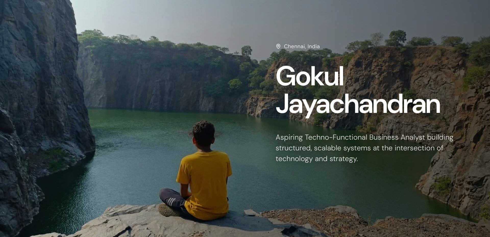
</a>

   
  &nbsp;
  &nbsp;
  
    
  &nbsp;&nbsp;&nbsp;
  &nbsp;&nbsp;&nbsp;
  &nbsp;&nbsp;&nbsp;
  

  

<!-- ===================== ABOUT ===================== -->

  <picture>
    <source media="(prefers-color-scheme: dark)" srcset="assets/h-about-dark.png">
    
  </picture>

<table>
  <tr>
    <td width="64%" valign="top">
      <picture>
        <source media="(prefers-color-scheme: dark)" srcset="assets/kural-dark.svg">
        
      </picture>
      
I believe meaningful progress is built through perseverance, thoughtful execution, and a willingness to learn beyond familiar boundaries. Whether solving a problem, leading an initiative, or stepping into a new environment, I strive to approach challenges with curiosity, resilience, and purpose.

      
My interests lie at the intersection of business and problem-solving, where technical understanding meets practical decision-making. I enjoy breaking down complex ideas, identifying what matters, and working on solutions that create value for organizations.

    </td>
    <td width="36%" valign="top">
      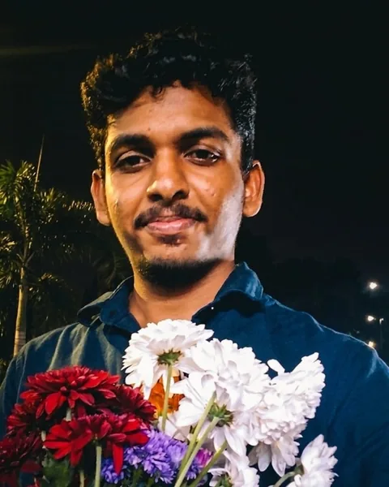
    </td>
  </tr>
</table>

 

<!-- ===================== SKILLS ===================== -->

  <picture>
    <source media="(prefers-color-scheme: dark)" srcset="assets/h-skills-dark.png">
    
  </picture>
    
  <picture>
    <source media="(prefers-color-scheme: dark)" srcset="assets/skills-dark.webp">
    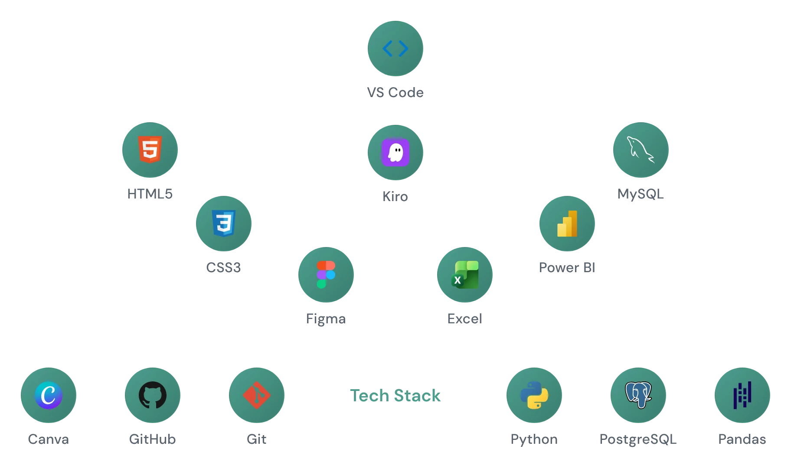
  </picture>

 

<!-- ===================== PROJECTS ===================== -->

  <picture>
    <source media="(prefers-color-scheme: dark)" srcset="assets/h-projects-dark.png">
    
  </picture>

<table>
  <tr>
    <td width="50%" valign="top">
      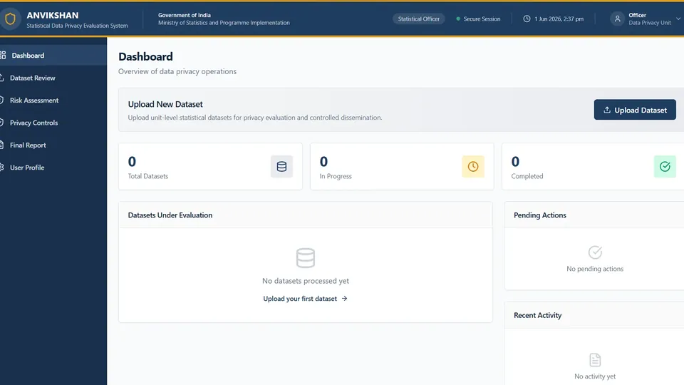
      <h3>Anvikshan</h3>
      
Government-grade data privacy enforcement system for unit-level datasets. Assesses anonymisation and encryption effectiveness, applies risk-based safeguards to sensitive identifiers, and enables controlled data dissemination while maintaining analytical utility and compliance.

      
<code>Python</code> <code>Encryption</code> <code>PostgreSQL</code> <code>Data&nbsp;Governance</code>

    </td>
    <td width="50%" valign="top">
      <a href="https://indicraft.vercel.app/login">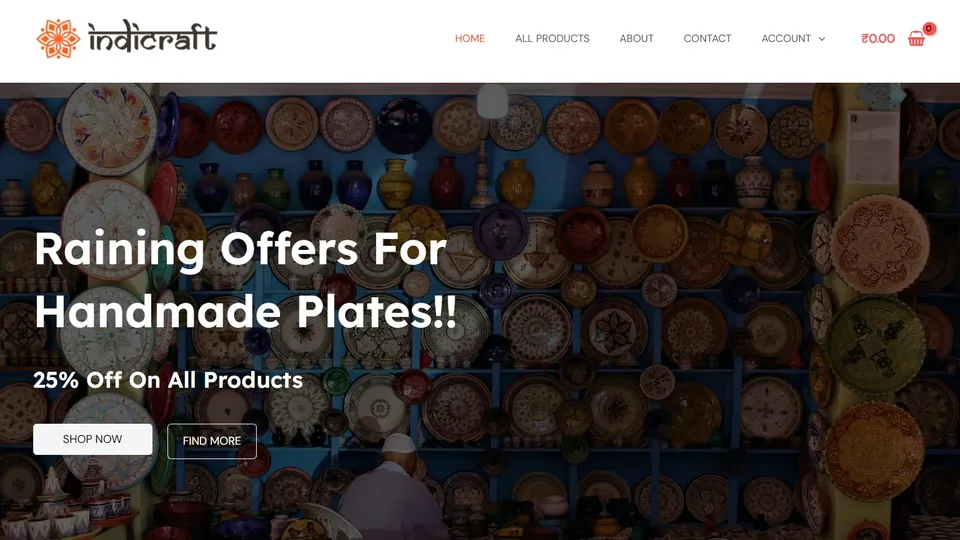</a>
      <h3>IndiCraft</h3>
      
AI-powered global marketplace connecting Indian artisans with international buyers. Features smart product discovery, regional and seasonal categorization, seller verification, and the DNK Scheme for affordable global export logistics — empowering rural creators through digital commerce.

      
<code>React</code> <code>Python</code> <code>AI/ML</code> <code>PostgreSQL</code>

      
<a href="https://indicraft.vercel.app/login"><b>↗ Live Demo</b></a>

    </td>
  </tr>
  <tr>
    <td width="50%" valign="top">
      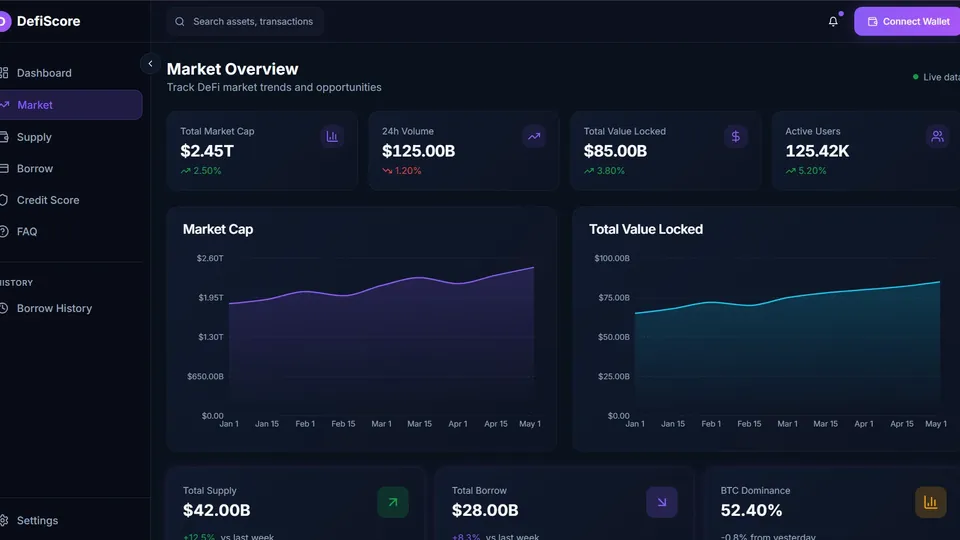
      <h3>DeFiScore</h3>
      
Production-ready decentralized credit scoring platform that computes wallet creditworthiness off-chain and verifies eligibility on-chain using Zero-Knowledge proofs — enabling under-collateralized DeFi lending without exposing credit scores or transaction history.

      
<code>Solidity</code> <code>Python</code> <code>Blockchain</code> <code>ZK&nbsp;Proofs</code> <code>Smart&nbsp;Contracts</code>

    </td>
    <td width="50%" valign="top">
      <a href="https://paimana-ai-tau.vercel.app/">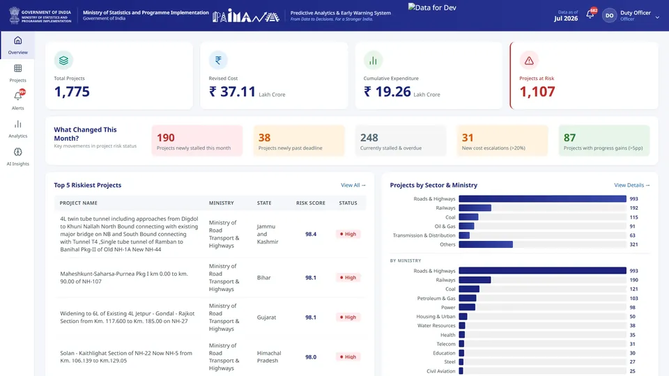</a>
      <h3>PAIMANA AI</h3>
      
AI-powered Predictive Analytics and Early Warning System for India's infrastructure project monitoring. Analyzes 1,981+ ongoing projects across 17 Ministries using ML models to forecast cost overruns, schedule delays, and implementation risks. Transforms PAIMANA's descriptive monitoring into predictive decision-support for policymakers.

      
<code>Python</code> <code>Machine&nbsp;Learning</code> <code>Big&nbsp;Data&nbsp;Analytics</code> <code>Predictive&nbsp;Modeling</code> <code>LLM</code>

      
⚠️ The backend may take a moment to load as it's hosted on Render's free tier. Please be patient on first visit.

      
<a href="https://paimana-ai-tau.vercel.app/"><b>↗ Live Demo</b></a> &nbsp;·&nbsp; <a href="https://github.com/gokeeel/paimana-ai"><b>Code</b></a>

    </td>
  </tr>
</table>

 

<!-- ===================== EXPERIENCE ===================== -->

  <picture>
    <source media="(prefers-color-scheme: dark)" srcset="assets/h-experience-dark.png">
    
  </picture>

<table>
  <tr>
    <td width="50%" valign="top" align="right">
      <code>Jan 2026 – Apr 2026</code>
      <h3>Software Developer Intern</h3>
      
<b>SprintXplore</b> 
      <a href="https://rocketsteer.com">↗ RocketSteer</a>

      
Developed DeFiScore, a privacy-preserving decentralized credit verification platform that combines blockchain technology, smart contracts, and secure eligibility assessment mechanisms for decentralized finance applications. Additionally, designed and built the frontend experience for RocketSteer, translating business requirements into intuitive, responsive, and scalable user interfaces. Worked across product planning, UI/UX implementation, and technical development to deliver solutions aligned with both user needs and business objectives.

    </td>
    <td width="50%" valign="top">
      <a href="https://rocketsteer.com">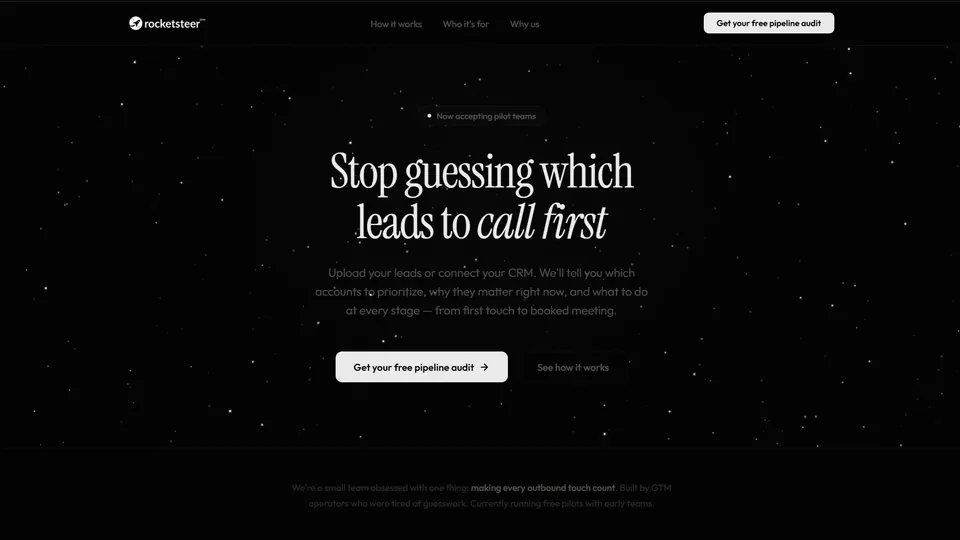</a>
    </td>
  </tr>
  <tr>
    <td width="50%" valign="top">
      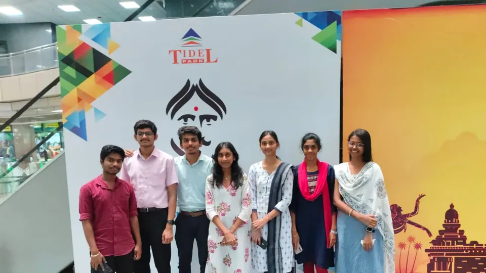
    </td>
    <td width="50%" valign="top">
      <code>Jun 2025 – Jul 2025</code>
      <h3>Marketing &amp; Sales Intern</h3>
      
<b>DOT CoWork</b>

      
Handled 50+ cold calls and led lead generation initiatives, conducting workspace tours for potential clients. Managed client onboarding processes and developed marketing strategies to optimize conversion rates. Utilized marketing funnels and UI/UX principles to enhance customer engagement and retention.

      <ul>
        <li>Lead Generation &amp; Client Acquisition</li>
        <li>Client Onboarding &amp; Retention</li>
        <li>Marketing Strategy &amp; Conversion Optimization</li>
      </ul>
    </td>
  </tr>
</table>

 

<!-- ===================== ACHIEVEMENTS ===================== -->

  <picture>
    <source media="(prefers-color-scheme: dark)" srcset="assets/h-achievements-dark.png">
    
  </picture>

<table>
  <tr>
    <td width="25%" valign="top">
      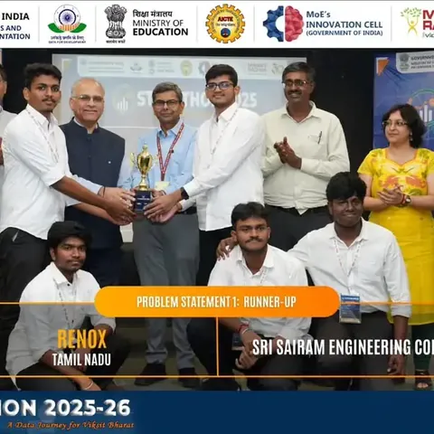
       <b>Statathon 2026 Winner</b>
       Won Statathon hackathon finals with Anvikshan, presented to MoSPI officials. Prize: ₹50,000 + ₹50,000 seed funding.
    </td>
    <td width="25%" valign="top">
      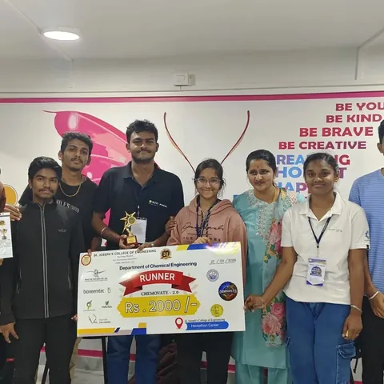
       <b>Chemovate 2026 Runner-up</b>
       Runner-up at Chemovate 2026 with an AI fabric-intelligence solution, showing teamwork and persistence.
    </td>
    <td width="25%" valign="top">
      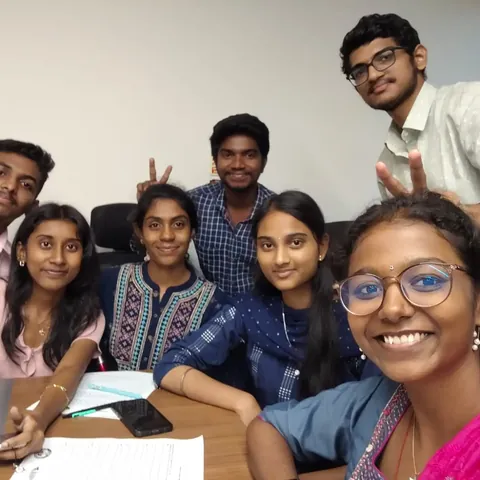
       <b>Internship at DOT CoWork</b>
       Completed an internship at DOT CoWork (Jun–Jul 2025), contributing to content, CRM, leads, and coordination.
    </td>
    <td width="25%" valign="top">
      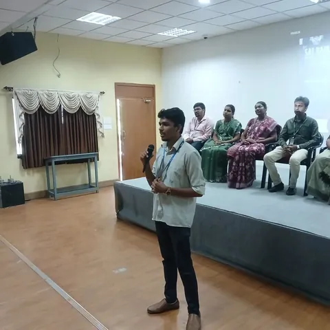
       <b>DMS Club Orientation Leadership</b>
       Represented the DMS Club during orientation week, promoting campus safety through student engagement.
    </td>
  </tr>
  <tr>
    <td width="25%" valign="top">
      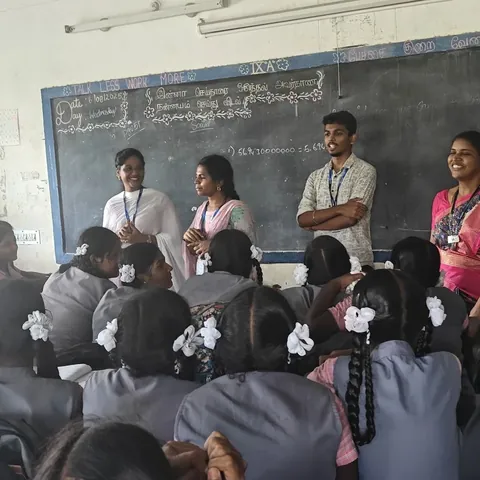
       <b>SHEILD School Visit</b>
       Supported IEEE SIGHT's visit to Nallur Government High School and highlighted hygiene challenges.
    </td>
    <td width="25%" valign="top">
      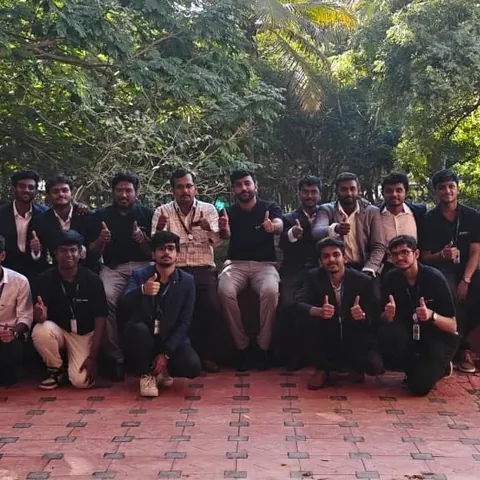
       <b>IEEE TEMS × HCL GUVI Hackathon</b>
       Coordinated a 24-hour hackathon with IEEE TEMS and HCL GUVI, strengthening planning and execution.
    </td>
    <td width="25%" valign="top">
      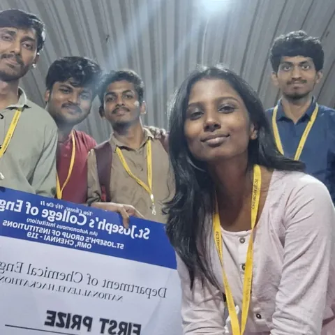
       <b>First Hackathon Experience</b>
       Joined my first hackathon at Chemovate 2025 and built a stronger mindset through the experience.
    </td>
    <td width="25%" valign="top">
      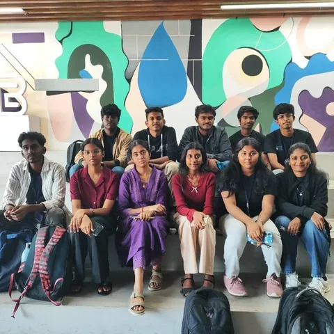
       <b>NxtGen 2026 Top 5%</b>
       Reached the Top 5% at NxtGen 2026 with ChainVoice, a blockchain solution for invoice fraud prevention.
    </td>
  </tr>
</table>

 

<!-- ===================== CONTACT ===================== -->

  <picture>
    <source media="(prefers-color-scheme: dark)" srcset="assets/h-contact-dark.png">
    
  </picture>
    
  &nbsp;&nbsp;&nbsp;
  &nbsp;&nbsp;&nbsp;
  &nbsp;&nbsp;&nbsp;
  
    
  <a href="mailto:gokuljai2006@gmail.com">gokuljai2006@gmail.com</a>
    
  Full portfolio → <a href="https://gokuljayachandran.vercel.app">gokuljayachandran.vercel.app</a>

